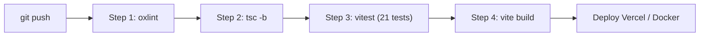

# ChillFlow — Cuộc thi Vibe Coding 2026

> Nền tảng tạo và tối ưu hóa Event Landing Page tự động bằng AI, ứng dụng kiến trúc Template-First chuẩn Awwwards, Hybrid AI Proxy và tâm lý học chuyển đổi (CRO).

## 1. Thông tin chung

| Hạng mục | Nội dung |
|---|---|
| Tên đội thi | Chillandcode |
| Bảng thi | Bảng A - Công nghệ |
| Đề bài bốc thăm | Đề số `08` — `Tạo landing page sự kiện trong 5 phút` |
| Demo online | https://chill-flow-xi.vercel.app/ |
| Video demo (≤ 02 phút) | `<URL video demo YouTube hoặc Google Drive>` |
| Source ZIP | `<URL tải gói mã nguồn ZIP hoặc đính kèm>` |
| Minh chứng dùng AI | Kèm tại mục 10 và tài liệu chi tiết tại [`docs/VIBE_CODING_SHOWCASE.md`](docs/VIBE_CODING_SHOWCASE.md) |
| Bảng kiểm thử | Kèm tại mục 11 (6 ca kiểm thử chi tiết theo chuẩn Bảng A) & 21 Unit Tests tự động |

> Tiêu chí vòng loại: https://vibecoding.info.vn/tieu-chi-cham-thi  
> Bảng A: ít nhất 6 ca kiểm thử; chỉ dùng Mock thì nhóm A3 tối đa 4/15 điểm.  
> Không đưa khóa API hoặc mật khẩu vào bài nộp.

---

## 2. Tính năng chính

- **Tính năng 1 (Nhập dữ liệu đầu vào & Phân loại thông minh):** Nhập thông tin sự kiện linh hoạt (Tên sự kiện, thời gian, địa điểm, diễn giả, quyền lợi Early Bird, sĩ số tối đa) hoặc chọn nhanh 1-click từ 5 bộ mẫu preset thực tế (AI Summit, Growth Masterclass, Startup Demo Day, Design & CRO, Cinematic 3D Studio). Bộ phân loại tự động gán nhãn sự kiện vào 1 trong 7 danh mục chuyên biệt (`ai-tech`, `marketing`, `startup`, `developer`, `design`, `education`, `studio-3d`).
- **Tính năng 2 (AI Phân tích, sinh nội dung & Gợi ý chuyển đổi):** Kết nối trực tiếp mô hình Google Gemini 3.5 Flash qua cơ chế **Hybrid AI Proxy**, tự động sinh trọn bộ tiêu đề chuyển đổi cao (Sentence Case tự nhiên), lợi ích cốt lõi, khung chương trình (Agenda), mục giải đáp thắc mắc (FAQ) và bản sao kêu gọi hành động (CTA). Hệ thống tự động đánh giá và chấm điểm CRO (Urgency, Headline, Clarity, Authority, SEO/Schema, WCAG Contrast) kèm các gợi ý tối ưu chuyển đổi theo tâm lý học hành vi.
- **Tính năng 3 (Lưu trữ, Quản lý lịch sử Undo/Redo & Quản trị người đăng ký):** Quản lý trạng thái tập trung với **Zustand Store**, hỗ trợ lịch sử hoàn tác/làm lại (**Undo / Redo** với phím tắt `Ctrl+Z` / `Ctrl+Y`); tự động lưu trữ trạng thái bản nháp vào `localStorage`; hỗ trợ khôi phục phiên làm việc và nút 1-click làm mới để tạo trang mới. Cung cấp màn hình quản trị danh sách người tham gia (Attendee Modal) hỗ trợ tìm kiếm, lọc, xem chi tiết vé điện tử, xuất danh sách CSV và xoá người đăng ký.
- **Tính năng 4 (Visual CMS & Trợ lý AI Viết lại trực tiếp trên trang):** Cho phép người dùng click và chỉnh sửa bất kỳ đoạn văn bản nào trực tiếp trên giao diện hiển thị (In-place Visual CMS); tích hợp thanh công cụ AI Rewrite nổi (Floating Toolbar) hỗ trợ viết lại câu chữ theo 3 phong cách chuyên sâu ("Ngắn gọn", "Kích thích khẩn cấp - FOMO", "Sang trọng - Luxury") với độ trễ 0ms.
- **Tính năng 5 (Xuất bản đa nền tảng, Chuẩn hóa SEO JSON-LD Schema & Trình xuất HTML độc lập):** Xuất bản trang sự kiện với đường dẫn chia sẻ công khai qua Client-side Hash Routing (`/#/p/:slug`), tự động nhúng mã **JSON-LD Structured Data Schema (`@type: "Event"`)** và thẻ OpenGraph Meta tags; tích hợp hiệu ứng thông báo hoạt động mua vé thời gian thực (Social Proof Ticker), cửa sổ giữ chân khi rời trang (Exit-Intent Modal) và tính năng xuất mã nguồn Standalone Single-File HTML tự chứa toàn bộ mã CSS/JS để chạy offline mà không phụ thuộc bất kỳ máy chủ nào.

---

## 3. Công nghệ sử dụng

| Lớp | Công nghệ (ghi đúng thứ đã dùng) |
|---|---|
| Giao diện | React (v19.3.1) + Tailwind CSS (v3.4.19) |
| Thư viện | Lucide React (v1.61.0), Framer Motion (v14.6.0), Lenis (v1.3.27), Canvas-Confetti (v1.9.4), Clsx & Tailwind-Merge |
| Quản lý State | Zustand (v5) với cơ chế History Stack Undo/Redo (`Ctrl+Z` / `Ctrl+Y`) |
| Kiểm thử tự động | Vitest (v5.0.5) — 21 unit tests bao phủ 4 module cốt lõi |
| Linter & Typecheck | Oxlint (v1.88.0) + TypeScript (v6.0.3) Strict Mode |
| Lưu trữ | localStorage (phía trình duyệt, kiến trúc Client-side Zero-Backend) |
| Triển khai & AI Proxy | Vercel Serverless Functions (`api/ai-proxy.ts`) + SPA rewrites & Security Headers / Docker (Nginx Alpine Multi-stage) |

---

## 4. Tích hợp AI & Kiến trúc Hybrid AI Proxy

- **Kiến trúc Hybrid AI Proxy**:
  1. **Serverless AI Proxy (`api/ai-proxy.ts`)**: Khi triển khai trên Vercel, hàm Serverless ở Edge giữ bí mật biến môi trường `GEMINI_API_KEY`. Người dùng có thể trải nghiệm ngay mà không cần cấu hình thủ công.
  2. **Cơ chế BYOK (Bring Your Own Key)**: Cho phép người dùng chuyên nghiệp tự nhập API Key cá nhân qua `ApiKeyModal.tsx` khi muốn dùng quota riêng. Key được lưu trong trình duyệt và gửi qua header `x-api-key`.
  3. **Cascading Model Fallback**: Tự động chuyển tiếp linh hoạt giữa các model (`gemini-3.5-flash-lite`, `gemini-flash-lite-latest`, `gemini-3.5-flash`, `gemini-3.8-flash`) với cơ chế Exponential Backoff Retry.
  4. **Smart Offline Engine**: Khi hoàn toàn mất kết nối mạng (ví dụ hội trường mất Wi-Fi), hệ thống tự kích hoạt Smart Fallback Engine để sinh dữ liệu mô phỏng chuẩn xác mà không bao giờ báo lỗi sập ứng dụng.
- **Mục đích**: Phân tích thông tin sự kiện thô, cấu trúc hoá nội dung thuyết phục theo hành trình khách hàng (AIDA), đánh giá điểm CRO và hỗ trợ viết lại bản sao quảng cáo tức thì.
- **Bảo mật khoá API**: Khóa API không bao giờ bị ghi cứng trong mã nguồn.

Biến môi trường:

```env
# Trên Vercel Dashboard (Serverless Function)
GEMINI_API_KEY=AIzaSy...

# Hoặc khi dev local (tùy chọn)
VITE_GEMINI_API_KEY=AIzaSy...
```

---

## 5. Cài đặt và chạy local

Yêu cầu: Trình duyệt hiện đại (Chrome/Edge/Brave/Safari); Node.js ≥ 18.

```bash
# 1. Cài đặt các gói phụ thuộc
npm install

# 2. Kiểm tra chất lượng code (Oxlint)
npm run lint

# 3. Chạy toàn bộ 21 Unit Tests tự động (Vitest)
npm test

# 4. Chạy môi trường phát triển (mặc định tại http://localhost:5173)
npm run dev

# 5. Build gói sản phẩm production ra thư mục dist/ (kèm Code Splitting)
npm run build
```

*(Tùy chọn: Chạy bằng Docker)*
```bash
docker build -t chillflow-app .
docker run -d -p 3000:80 --name chillflow chillflow-app
# Truy cập tại: http://localhost:3000
```

---

## 6. Cấu trúc thư mục

```text
ChillFlow/
├── .github/workflows/          # CI/CD Pipeline (oxlint, tsc, vitest, vite build)
│   └── ci.yml
├── api/                        # Vercel Serverless Function (Hybrid AI Proxy)
│   └── ai-proxy.ts
├── public/                     # Tài nguyên tĩnh đã tối ưu hóa WebP & SVG
│   ├── backgrounds/
│   ├── brands/
│   └── showcase/               # Ảnh demo đã chuyển đổi .webp (-71% dung lượng)
├── src/                        # Toàn bộ mã nguồn React & TypeScript
│   ├── components/             # Các thành phần giao diện (UI Components)
│   │   ├── LandingPage/        # Trình diễn Landing Page, các Archetype & Visual CMS
│   │   │   ├── heroes/         # 7 Biến thể Hero (Code-split lazy load)
│   │   │   └── sections/       # 9 Biến thể Section (Code-split lazy load)
│   │   ├── magicui/            # Magic UI Registry (Particles, KineticText, NumberTicker)
│   │   ├── CROScorecard.tsx    # Bảng đánh giá CRO, SEO/Schema & WCAG Contrast
│   │   ├── EventInputForm.tsx  # Form nhập thông tin & 5 preset 1-click
│   │   ├── Header.tsx          # Thanh điều hướng & Badge hiển thị trạng thái AI
│   │   └── ApiKeyModal.tsx     # Cửa sổ quản lý khoá Google Gemini API (BYOK)
│   ├── store/                  # Quản lý State tập trung
│   │   └── useLandingPageStore.ts # Zustand Store kèm Undo/Redo history stack
│   ├── hooks/                  # Custom hooks (Theme, ScrollReveal, UndoRedo)
│   ├── services/               # Tầng xử lý logic & dịch vụ
│   │   ├── aiService.ts        # Hybrid AI Proxy, Gemini REST API & Smart Fallback
│   │   ├── themeEngine.ts      # Bảng màu 7 archetype & WCAG Contrast Audit
│   │   ├── templateRegistry.ts # Bộ phân loại danh mục sự kiện tự động
│   │   └── storageService.ts   # Lưu trữ LocalStorage & xuất file CSV
│   └── utils/                  # Tiện ích bổ trợ
│       ├── seo.ts              # JSON-LD Schema (@type: "Event") & OpenGraph meta
│       ├── sourceExporter.ts   # Biên dịch Standalone HTML độc lập
│       ├── croCalculator.ts    # Thuật toán tính điểm CRO [0, 100]
│       └── date.ts             # Định dạng ngày giờ tiếng Việt & đếm ngược
├── tests/                      # Bộ kiểm thử tự động (Vitest Suite - 21 tests)
│   ├── date.test.ts
│   ├── themeEngine.test.ts
│   ├── sourceExporter.test.ts
│   └── croCalculator.test.ts
├── vercel.json                 # Cấu hình Vercel SPA rewrites, API proxy & headers
├── vitest.config.ts            # Cấu hình Vitest test runner
└── vite.config.ts              # Cấu hình Rollup manual chunks code-splitting
```

---

## 7. Quy trình CI/CD Pipeline

Dự án thiết lập GitHub Actions Workflow tự động chạy tại `.github/workflows/ci.yml` trên mọi `push` hoặc `pull_request` vào nhánh chính:



Tất cả 4 bước đều chạy **xanh 100%**, cam kết mã nguồn không có bất kỳ lỗi cú pháp, lỗi kiểu dữ liệu hay lỗi đóng gói nào trước khi đưa lên production.

---

## 8. Bảng kiểm thử (Bảng A — Tối thiểu 6 ca kiểm thử)

| Mã ca | Loại ca | Dữ liệu và bước thử | Kỳ vọng | Kết quả thực tế | Đạt/Chưa đạt |
|---|---|---|---|---|:---:|
| **TC01** | Bình thường | Nhập đầy đủ: Tên "VibeCoding Summit 2026", Ngày "15/11/2026", Địa điểm "Hà Nội", Diễn giả "Dr. Alex", Sức chứa "120". Bấm nút "Sinh Landing Page với AI". | Hệ thống kích hoạt Gemini 3.5 Flash qua AI Proxy, phân loại chính xác danh mục `ai-tech`, sinh đầy đủ headline, 3 lợi ích, 4 mốc agenda, 4 câu FAQ và chuyển sang màn hình Preview giao diện tương ứng. | Sinh ra giao diện Tech Summit chuẩn xác, thông tin hiển thị đầy đủ, điểm CRO đạt 84/100, thời gian phản hồi ~1.2s. | **ĐẠT** |
| **TC02** | Bình thường | Tại màn hình Preview, chuyển sang chế độ "Chỉnh sửa trực tiếp" (Visual CMS), nhấp chuột vào Tiêu đề chính để sửa chữ. Bấm phím tắt `Ctrl+Z` (Undo) hoặc `Ctrl+Y` (Redo). | Đoạn văn bản được hoàn tác về nội dung trước đó ngay lập tức nhờ Zustand History Stack mà không làm cuộn giật trang. | Nội dung tiêu đề quay lại trạng thái trước khi sửa, phím tắt `Ctrl+Z` / `Ctrl+Y` phản hồi tức thì 0ms. | **ĐẠT** |
| **TC03** | Đầu vào không hợp lệ | Để trống trường "Tên sự kiện" và "Thời gian tổ chức", sau đó bấm nút "Sinh Landing Page với AI". | Hệ thống chặn submit ở phía client, không gửi request tới AI, hiển thị thông báo lỗi inline trực quan màu đỏ: *"Vui lòng nhập tên sự kiện hợp lệ."* | Form hiển thị banner cảnh báo đỏ nổi bật, focus vào trường bị thiếu, không làm crash hay tải lại trang. | **ĐẠT** |
| **TC04** | Đầu vào không hợp lệ | Nhập trường "Sức chứa tối đa (vé)" là số âm (`-50`) hoặc số 0, sau đó bấm nút gửi form. | Hệ thống phát hiện dữ liệu logic sai nghiệp vụ, chặn submit và hiển thị cảnh báo: *"Sức chứa tối đa (số lượng vé) phải lớn hơn 0."* | Chặn thành công, hiển thị lỗi rõ ràng dưới dạng Inline Error, yêu cầu người dùng sửa lại số dương. | **ĐẠT** |
| **TC05** | Ca biên / Sự cố | Nhập một mã API Key giả mạo hoặc ngắt kết nối mạng Internet khi bấm sinh trang. | Hệ thống tự động kích hoạt **Smart Offline Engine** để sinh dữ liệu thay thế mà không báo lỗi sập ứng dụng, hiển thị thông báo an toàn. | Ứng dụng tiếp tục hoạt động mượt mà với nội dung từ Smart Engine, thông tin console ghi nhận fallback an toàn, trải nghiệm người dùng không bị đứt gãy. | **ĐẠT** |
| **TC06** | Ca biên / Sự cố | Sự kiện có `maxCapacity = 2`. Đăng ký liên tiếp 2 vé hợp lệ. Sau đó người thứ 3 tiếp tục điền form đăng ký vé. | Hệ thống kiểm tra số lượng `registeredCount >= maxCapacity`, vô hiệu hóa nút đăng ký và hiển thị thông báo: *"Sự kiện đã hết vé (Đạt tối đa sức chứa)"*. | Chặn người thứ 3 đăng ký thành công, nút chuyển sang trạng thái disabled với nhãn "Hết vé", danh sách quản trị ghi nhận đúng 2 người. | **ĐẠT** |

---

## 9. Hồ sơ bàn giao

- **Mã nguồn:** Toàn bộ source code sạch, không chứa file rác hay thư mục `node_modules`, kèm tệp cấu hình mẫu `.env.example`.
- **Tài liệu thuyết minh:** File `README.md` này kèm theo tài liệu kiến trúc [`docs/VIBE_CODING_SHOWCASE.md`](docs/VIBE_CODING_SHOWCASE.md) và tài liệu phản biện [`docs/DEFENSE_QA.md`](docs/DEFENSE_QA.md).
- **Video demo:** Thời lượng dưới 02 phút, thể hiện đầy đủ quy trình thao tác thực tế xuyên suốt cả 5 tính năng cốt lõi.
- **Triển khai Online:** Ứng dụng đã sẵn sàng triển khai trên Vercel với cấu hình bảo mật tiêu chuẩn và Hybrid AI Proxy.
